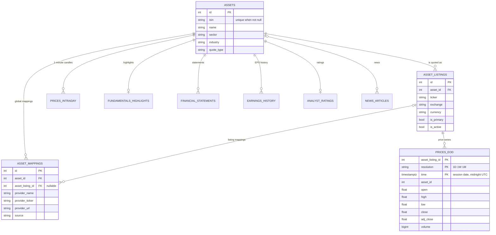

# 数据模型与 Schema 参考

金融工具的身份分为三个层级：

- `assets`——金融工具，每个 ISIN 一个；
- `asset_listings`——其报价位置：代码、交易所、货币；
- `asset_mappings`——金融工具或某个上市品种在特定数据提供方处的标识符（Yahoo 代码、页面 URL……）。

同一个 ISIN 会以多个代码和货币上市；同一个代码在不同市场上可能指代不同的金融工具；而各数据提供方接受的标识符也不尽相同。`models.py` 是所有列的权威参考。

## 身份

| 表 | 规则 |
|---|---|
| `assets` | 每个 ISIN 一行：部分唯一索引 `uq_assets_isin_not_null`（`WHERE isin IS NOT NULL`） |
| `asset_listings` | 在 `(asset_id, ticker, exchange, currency)` 上唯一（`uq_asset_listing_identity`）；`is_primary` 标记默认上市品种 |
| `asset_mappings` | 在 `(asset_listing_id, provider_name)` 上唯一。不关联上市品种的映射适用于该金融工具的所有上市品种。`source` 说明标识符的来源：`csv_import`、`manual`、`isin_search`、`ticker_check`、`symbol_not_found`。 SEC 的 CIK 是金融工具的一个映射（提供方 `SEC`，不关联上市品种），其 ESEF 报告的 LEI 也是如此（提供方 `LEI`，来源 `isin_check`） |

上市品种的 Yahoo Finance 映射保存其**已验证的代码**——根据 ISIN 查得并按上市品种的货币核对——或者在 `source = 'manual'` 时，保存你手动设置的代码。

## 价格

| 表 | 说明 |
|---|---|
| `prices_eod` | TimescaleDB 超表。键为 `(asset_listing_id, resolution, time)`：每个上市品种和分辨率对应一个序列。`time` 是交易日日期，取 UTC 午夜时刻。`open`、`high`、`low`、`close` 是已针对拆股调整的成交价格；`adj_close` 还针对分红进行了调整。超过 14 天的分块会被压缩（按上市品种和分辨率分段） |
| `price_series_adjustments` | 每个序列（上市品种和分辨率）一行：其 K 线的调整方式（`scheme`）以及最后一次整体获取的时间（`fetched_at`）。没有对应行的序列会在下一次采集时被完整地重新获取 |
| `prices_weekly`, `prices_monthly` | 基于日线的连续聚合，按上市品种计算，每天刷新；当该上市品种没有存储 `1W`/`1M` 行时使用 |
| `prices_intraday` | 来自实时数据流的 1 分钟 K 线超表，按金融工具存储，分块为一天，30 天后清除 |
| `realtime_subscriptions` | 正在推送的代码，启动时恢复 |
| `ingest_log` | 每次采集一行：状态、来源、行数、区间、耗时、错误 |

## 基本面

| 表 | 说明 |
|---|---|
| `fundamentals_highlights` | 金融工具的最新快照（估值、盈利能力、股息、空头头寸、偿债能力）。`dividend_yield` 为比率 |
| `financial_statements` | 每种报表类型（利润表、资产负债表、现金流量表）、财务期间和频率各一行。一个财年为三行；计算时通过 `financials/fiscal_years.py` 将它们组合起来。 `currency` 是 Yahoo 给出的报表货币（未知时为 `NULL`）；DCF 以该货币进行 |
| `xbrl_facts` | SEC XBRL 申报的事实，与 Yahoo 的数据分开保存：每个 `(cik, taxonomy, concept, unit, period_end, duration_days)` 一个值。时点资产负债表的 `duration_days` 为 0。重述会替换该值，`accession`、`form` 和 `filed` 注明其来源申报文件 |
| `sec_company_loads` | 每家公司（CIK）一行：SEC 上的名称、最近一次读取其事实的时间、保存的最新申报、事实数量 |
| `esef_filings` | filings.xbrl.org 索引中的 ESEF 报告，每个 `fxo_id` 一行：公司的 LEI、索引给出的期间（可能有误）、国家、链接、错误数量，以及最近一次读取的结果：`read_status`（`read`、附原因的 `refused`、`missing`）、`report_end`（取自数字的真实期间）、保存的数值、舍弃的细分和舍弃的冲突数量 |
| `esef_facts` | ESEF 报告的合计数，与 Yahoo 的数据分开保存：每个 `(lei, taxonomy, concept, unit, period_end, duration_days)` 一个值；`taxonomy` 为 `ifrs-full` 或公司扩展的前缀。重述会替换该值；`fxo_id` 指明报告，数值随报告一起删除 |
| `esef_entity_loads` | 每家公司（LEI）一行：法定名称、最近一次读取其报告的时间、报告数量、已读取的最新期间、数值数量 |
| `earnings_history`, `earnings_trend` | 实际与预估每股收益；分析师对 `0q`、`+1q`、`0y`、`+1y` 的预估 |
| `analyst_ratings` | 一致评级、目标价、评级数量 |
| `esg_scores` | E/S/G 评分及 15 个争议标志 |
| `outstanding_shares_history` | 股本数量历史 |
| `etf_details`, `etf_holdings` | 用于读取 ETF 信息，但目前应用不会写入 |
| `fundamentals` | 旧版表，不再写入 |

这些表由基于 Yahoo Finance 的深度补全写入（`/fundamental/deep`、`import_assets.py --enrich-only`）。

## 新闻、宏观与使用情况

| 表 | 说明 |
|---|---|
| `news_articles` | 在 `url` 上唯一；为信息流和统计建有索引。旧文章不会自动清除 |
| `macro_rates_cache` | 从 FRED 和 ECB 读取的序列（`source`），在 `(series_id, observation_date)` 上唯一 |
| `macro_observations` | Eurostat 指标，每个 `(source, indicator, geo, period)` 一个值；期间以其第一天标注，修订会替换该期间的值；`status` 保留 Eurostat 的标记（`e` 表示估计值） |
| `macro_series_loads` | 每个序列（指标和国家）一行：最近一次读取的时间、第一个和最后一个期间、Eurostat 公布的最近更新时间 |
| `yield_curve_points` | 美国财政部的每日收益率曲线（名义曲线自 1990 年起，实际曲线自 2003 年起）：每个 `(source, curve, rate_date, tenor)` 一个利率，以比率表示（实际收益率可能为负）；`tenor_months` 用于排序曲线；某天未公布的期限没有行 |
| `yield_curve_loads` | 每条曲线每年一行：最近一次读取的时间、天数、第一天和最后一天。在年末之后读取过的过去年份不再重新读取 |
| `cot_weeks` | CFTC 交易商持仓报告（`legacy` 自 1986 年起，`tff` 和 `disaggregated` 自 2006 年 6 月起）：每个 `(report, market_code, report_date)` 一行，市场以其 CFTC 合约市场代码（`13874A`）表示，附该周的市场名称、合约单位和未平仓合约 |
| `cot_positions` | 一行中各类交易商的持仓，单位为合约数：`long`、`short`，以及有价差头寸的类型的 `spreading`（在 Legacy 历史数据中，非报告头寸可能为负）；随所属行一同删除 |
| `cot_loads` | 每种报告每年一行：最近一次读取的时间、包含该年的文件、报告日期数量、第一个和最后一个日期。2016 年及以前的年份来自每种报告的一个历史文件 |
| `usage_logs` | 每个 API 请求一行，由后台批量写入；除非 `USAGE_LOG_IP` 要求，否则不保留 IP；在 `USAGE_LOG_RETENTION_DAYS` 之后清除 |

## 因子与汇率 {#factors-and-exchange-rates}

| 表 | 说明 |
|---|---|
| `factor_returns` | Kenneth French Data Library 的收益，以比率和美元计。键为 `(dataset, frequency, period_end, factor)`；每次下载时整个文件被替换 |
| `factor_dataset_loads` | 每个文件（数据集和频率）一行：下载时间、第一个和最后一个周期、周期数、`source_note`（例如 `CRSP 202608`） |
| `fx_rates` | 欧洲央行参考汇率：一欧元可兑换的 `currency` 单位数 `per_eur`，键为 `(currency, rate_date)` |
| `fx_rate_loads` | 每种货币一行：最近一次请求的时间、已存储的第一天和最后一天 |

请参阅 [Fama/French 因子](../api-reference/factors.md)。

## 监控

| 表 | 说明 |
|---|---|
| `provider_health_log` | 超表，每个被检查的值一行（`check_type` 为 `canary`、`realtime` 或 `consensus`），保留 30 天 |
| `provider_health_daily` | 每个数据提供方的每日聚合，在 `(provider_name, date)` 上唯一 |
| `provider_alerts` | `canary_failed` 和 `high_outlier_rate` 告警，包括活跃和已解决的 |
